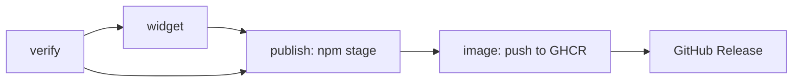

# B48 Docker image on GitHub's container registry

## Goal

Someone without Node can run the always-on dashboard with Docker alone: download one
compose file, `docker compose up -d`, and the dashboard answers at
<http://localhost:4747> (where the taskbar widget already looks), updated with
`docker compose pull`. Each release publishes the image next to the npm package and the
widget exe.

## Acceptance criteria

- AC1 WHEN `npm run image:check` runs, THE SYSTEM SHALL build the image, start it through
  `docker/compose.yaml` with an override that swaps in the local image, temp Claude and data
  dirs and a free loopback port, and pass only if the container turns healthy, `GET /`
  answers 200 with HTML, `GET /api/health` answers ok, and a request with
  `Host: example.com` gets 403; it then removes the container and network, pass or fail.
- AC2 IF the merged compose config mounts any path other than the two temp dirs, THEN
  `image:check` SHALL stop with an error before starting anything (check: the script reads
  `docker compose config --format json` before `up`).
- AC3 THE published compose file SHALL publish only `127.0.0.1:4747` → 4173, mount
  `~/.claude` read-only at `/claude` and `~/.claude-code-analytics` at `/data`, keep
  `read_only`, the `/tmp` tmpfs, `cap_drop: ALL` and `no-new-privileges`, and join no
  external network (check: `image:check` asserts these on the file's own config, without
  the override).
- AC4 WHEN a tag `vX.Y.Z` is pushed and the npm version is staged, `release.yml` SHALL push
  `ghcr.io/pierre-demessence/claude-analytics-dashboard` tagged `X.Y.Z`, `X.Y` and `latest`
  for `linux/amd64` and `linux/arm64`, and create the GitHub Release only after that push
  (check: the workflow's `needs` chain; first real release by the user).
- AC5 IF `verify`, `widget` or `publish` fails, THEN no image SHALL be pushed (check: `needs`).
- AC6 `ci.yml` SHALL run `npm run image:check` on every push and pull request to `main`, and
  the release's `verify` job SHALL run it before anything is published.
- AC7 WHEN a user follows the README's Docker section, THE SYSTEM SHALL serve their history at
  <http://localhost:4747> with no hook installed, importing every minute (check: manual, after
  the first release with the image).

## Design

- **Image.** The root `Dockerfile` stays the one image for both setups. Its build stage gets
  `FROM --platform=$BUILDPLATFORM`: `dist/` and `lib/` are platform-independent, and the
  final stage has no `RUN`, so a multi-arch build compiles once natively and needs no QEMU.
- **Compose file for users:** `docker/compose.yaml`, top-level `name: claude-analytics-dashboard`
  so the project name does not depend on the folder it is downloaded to. Not at the root: a
  root `compose.yaml` wins over `docker-compose.yml` and would hijack `npm run docker:up`.
  `image: ghcr.io/pierre-demessence/claude-analytics-dashboard:latest`, `init`,
  `restart: unless-stopped`, the same hardening and mounts as `docker-compose.yml` with `~`
  paths (Compose expands `~` on Windows too: checked with Compose v5.7), and
  `ports: ["127.0.0.1:4747:4173"]` on the project's own default network. Port 4747 is the
  npm server's: the widget, the npm hook (if one is installed) and the URL stay the same.
- **No hook for Docker users.** The server already imports every minute (`api.ts`
  `COLLECT_EVERY_MS`); a hook would mean hand-editing `settings.json`, since the container
  mounts `~/.claude` read-only. Someone who also has the npm package's hook gets it answered
  by the container on the same port.
- **`scripts/image-check.ts`** (`npm run image:check`), modeled on `pack-check.ts`:
  `docker build -t cca-image-check .`, then `docker compose -p cca-image-check -f
  docker/compose.yaml -f <temp override>` where the override uses `!override` for `image`,
  `ports` and `volumes`. Commands are spawned with argument arrays. Cleanup is
  `compose down` in a `finally`. Docker must be running; the script says so if not.
- **Release.** A new `image` job in `release.yml`, `needs: publish` (so it runs only after the
  npm version is staged), `permissions: contents: read, packages: write`, using
  `docker/setup-buildx-action@v4`, `docker/login-action@v4` (`GITHUB_TOKEN`),
  `docker/metadata-action@v6` (semver tags `{{version}}`, `{{major}}.{{minor}}`, `latest`; it
  adds the `org.opencontainers.image.source` label that links the package to the repository)
  and `docker/build-push-action@v7`. `release` then needs `[publish, widget, image]`.
  The image goes live at once, unlike the npm version, which waits for 2FA approval.

- **Edge cases, documented in the README:** on Linux, a missing `~/.claude-code-analytics`
  is created by Docker as root and the container's `node` user (uid 1000) cannot write it:
  create it first, and set `user:` when the host uid is not 1000. The npm package and the
  container both want port 4747: run one.
- **Invariant change.** AGENTS.md's "never publish a port" applies to the Traefik setup; the
  published compose file publishes only on `127.0.0.1`, with the same Host check behind it.

## Checklist

### B48.1 Image check and user compose file

- [ ] `Dockerfile`: `--platform=$BUILDPLATFORM` on the build stage.
- [ ] `docker/compose.yaml` as in Design.
- [ ] `scripts/image-check.ts` and the `image:check` npm script covering AC1–AC3.
- [ ] `ci.yml`: `npm run image:check` in the `build` job, after `pack:check`.
- [ ] Verify: `npm run image:check` passes locally; lint, tests, build pass.

Visible after: nothing: the image is only built locally and in CI.
Needs you: nothing.

### B48.2 Publish the image on release

- [ ] `release.yml`: `npm run image:check` in `verify`; the `image` job; `release` needs it.
- [ ] Verify: `actionlint` if available, else a careful read of the `needs` chain against
  AC4–AC5; no tag is pushed.

Visible after: nothing until the next release tag; then the image is on GitHub's registry.
Needs you: after the first release with it, open the package page on GitHub and make it
public if it is private (at the end).

### B48.3 Docs and finish

- [ ] `README.md`: a user section "Always-on dashboard (Docker)" (download, `up -d`, update,
  uninstall, the Linux and port notes, no hook needed); the clone/Traefik section stays for
  contributors; the widget paragraph links the new section.
- [ ] `AGENTS.md`: `image:check` in Commands, `docker/` in Layout, the port invariant and the
  release invariant (the image job) updated.
- [ ] `docs/decisions.md`: "Collect from a Claude Code `Stop` hook" no longer rejects Docker
  for friends; "Always-on dashboard" names the published image and why the Traefik setup
  still builds locally (it runs reviewed working-copy code).
- [ ] `CHANGELOG.md` under Unreleased; delete B48 from the backlog and the roadmap entry;
  delete this plan.

Visible after: the README offers Docker as an install without Node.
Needs you: after the first release with the image, follow the README's Docker steps and
check the dashboard at <http://localhost:4747> shows your history (at the end).
